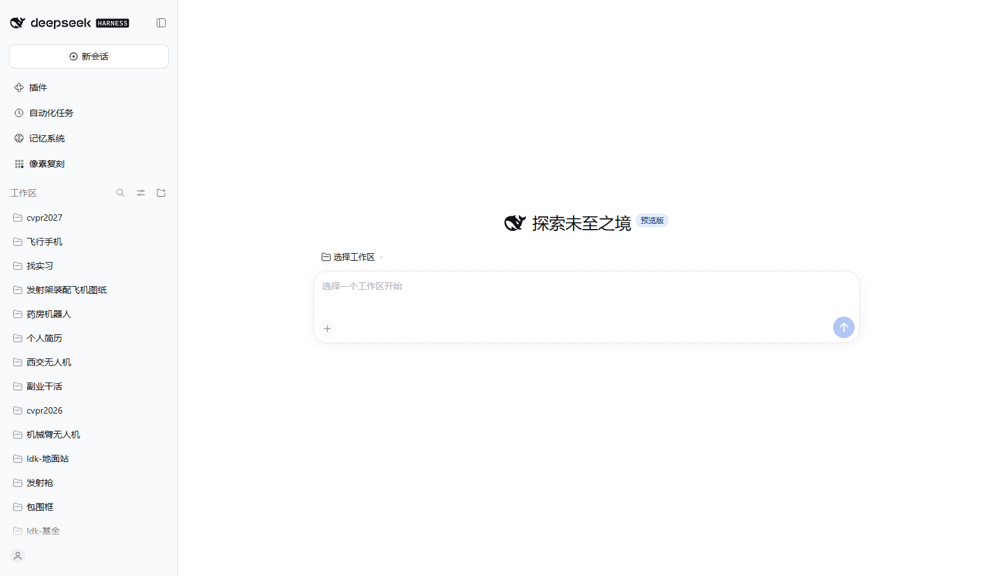
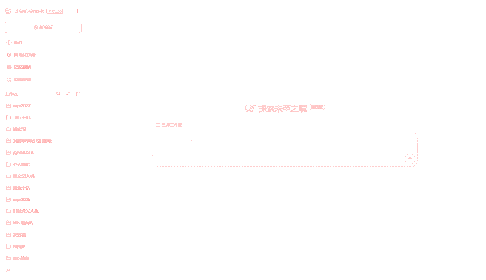

# PixelTrace — 像素复刻

Turn **any image into an editable PowerPoint** whose objects sit at the exact same
pixels: one flat colour region becomes one shape you can recolour, one photo or
one text label becomes one precisely cropped picture. No cloud service, no
dependencies, no LibreOffice required to build the deck.

PixelTrace is a **DSH Harness plugin** (a Cordis bundle with a Web UI panel). You
drop a screenshot into the panel, watch the reconstruction and the difference
heat map, and export a `.pptx` in the browser.

| Source image | Exported PPTX, rendered by LibreOffice |
| --- | --- |
|  |  |

The recorded diff of that pair is **98.49 % pixel-identical** (21 581 mismatching
pixels out of 1 430 848, mean absolute error 0.070, max 34) — every residual pixel
sits on a shape edge, as the amplified heat map shows:



## Why it is pixel-exact

`1 px = 9525 EMU` is **exact** at 96 dpi, so a rectangle at `(x, y, w, h)` pixels
lands on exactly `(x, y, w, h)` pixels of the slide. On top of that PixelTrace:

* decomposes flat areas into maximal rectangles by exact colour equality (no
  seams, no overlaps, integer geometry only),
* keeps photo/text regions as **exactly cropped PNG pictures** placed 1:1,
* re-rasterises its own scene and diffs it against the source before you export,
  so the panel reports the true fidelity of what you are about to get
  (typically `完全一致像素 100 %`).

## Features

* Drag & drop, file picker, or `Ctrl+V` paste; several images become several
  slides, exported as one deck.
* Three output modes:
  * **智能分层 / Smart** (default) — flat areas become editable shapes, detail
    areas become exact crops. Lossless by default.
  * **纯矢量 / Vector** — shapes only, honest fidelity report for the loss.
  * **整图保真 / Image** — the picture as a single full-bleed image.
* Shape budget with graceful degradation (expand crops → loosen merge tolerance →
  whole image as one picture) and a note in the report explaining what happened.
* Palette quantisation (`maxColors`) that re-colours flat shapes only and leaves
  crops untouched, colour merge tolerance, optional empty text boxes for text
  regions, transparent-image background, slide size cap.
* Preview: source, reconstruction, amplified difference heat map; fit or 1:1.
* Fidelity statistics: exact pixel ratio, mismatch count, object/rect/crop/text
  counts, palette size, mean and max channel error, elapsed milliseconds.
* Bilingual UI (中文 / English), Harness theme tokens, sidebar panel +
  `Ctrl+V`-friendly workspace.

## Measured on this machine

| Input | Objects | Time | Self-reported fidelity | Deck |
| --- | --- | --- | --- | --- |
| 800 × 500 synthetic UI | 61 shapes (50 rect, 11 crops) | 84 ms | 100 % exact | 38 KB, 1 slide |
| 1576 × 908 real UI screenshot | 695 shapes (668 rect, 27 crops) | 172 ms | 100 % exact | 65 KB, 1 slide |
| 1576 × 908 deck rendered by LibreOffice | — | — | 98.49 % exact, meanAE 0.070 | — |

Node-side checks: `node --test test/` (engine, OOXML/ZIP/PNG, bundle + panel
contract) and `node tools/verify.mjs` (end-to-end pipeline + independent OOXML
validation).

## Install into DSH Harness

The package is a Cordis bundle (`dsh.bundle.patch` → `cordis.patch.yml`), so it is
installed like any other DSH plugin bundle:

```text
plugin_manager { action: "install_bundle", target: "<absolute path to this repo>" }
```

The panel then appears in the sidebar as **像素复刻 / PixelTrace** (order 32, after
the built-in panels). The bundle is linked, not copied, so edits in this repo take
effect on the next panel load.

## Use

1. Open the **像素复刻** panel from the sidebar.
2. Drop an image (PNG/JPEG/WebP/GIF), or paste it with `Ctrl+V`.
3. Pick a mode; tweak the budget, tolerance, palette or crop settings. Every
   change re-analyses immediately.
4. Check the **差异** view and the statistics — "完全一致像素" is computed by
   rasterising the very shapes that go into the deck.
5. Click **导出 PPTX**. One image → one slide; the file lands in your download
   folder (or a Save dialog, when the browser supports it).

Everything in the deck is an individual object: recolour a block, move it, delete
it, or replace a cropped picture — in PowerPoint, WPS or Keynote.

## How it works

```text
image ──decode──► RGBA
      ──sceneBuild──► Scene { rects (editable shapes) + crops (exact PNG) }
      ──sceneRasterize──► RGBA' ──sceneDiff──► exact %, heat map
      ──pptxBuild──► OOXML package ──pptxZip──► .pptx
```

* `src/scene.frag.js` — image analysis, exact rectangle decomposition, smart
  region split, optional text-region detection, rasteriser, diff metrics.
* `src/pptx.frag.js` — dependency-free PresentationML writer, ZIP (deflate-raw
  with a stored fallback, fixed DOS timestamps, no ZIP64), PNG encoder/decoder.
* `src/ui.frag.js` — the panel (React via `h()`, no JSX, no bundler).
* `src/entry.frag.js` — options, defaults, deck assembly, save helpers.
* `src/*.frag.js` are plain script fragments: no imports, no top-level await.
  `tools/build.mjs` concatenates them into `lib/client.js` inside the Harness
  module factory; Node tooling evaluates the same fragments with `new Function`.
  The repository is never built by a bundler and has zero npm dependencies.

## Development

```bash
node tools/build.mjs                 # src/*.frag.js -> lib/client.js
node --test                          # engine + container + bundle tests
node tools/verify.mjs                # end-to-end pipeline, writes out/verify/
node tools/verify.mjs compare a.png b.png   # pixel diff of two images
node tools/verify.mjs diffmap a.png b.png out.png  # amplified diff map
node tools/browser-check.mjs <authenticated dsh web URL> [--image shot.png]
```

`tools/browser-check.mjs` drives a headless Edge over CDP: it opens the GUI,
clicks the sidebar entry, drops an image, reads the statistics, exports the deck
and validates the produced OOXML with an independent parser.

## Limits

* Real PowerPoint/LibreOffice rendering introduces sub-pixel anti-aliasing on
  shape edges; the shapes themselves are pixel-exact, the rasteriser of the slide
  is not. Expect ~98 % and a max error in the tens on very thin features.
* Lossless smart mode grows with the number of distinct colours per region; a
  noisy photograph becomes one big crop, which is correct but edits as a picture.
* Cropped pictures are 8-bit RGBA PNGs; 16-bit / interlaced PNG input is decoded
  through the browser, so any format the browser decodes works.
* No shape-budget magic: extremely detailed images in `vector` mode degrade to
  fewer, larger rectangles and report the loss instead of silently dropping
  objects.

## License

MIT — see [LICENSE](LICENSE).
