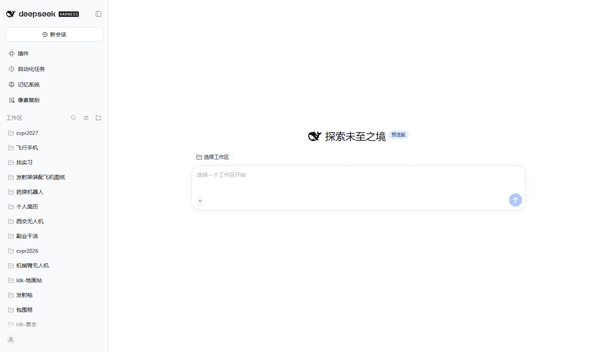
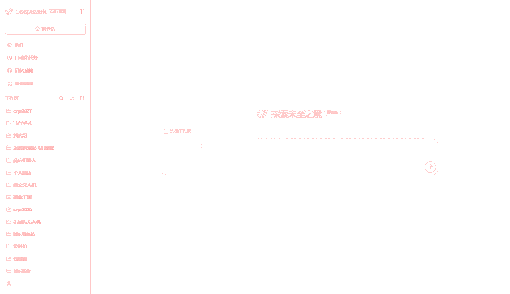

# 像素复刻 PixelTrace

把**任意一张图片变成可编辑的 PowerPoint**：每一块纯色区域变成一个能改颜色的形状，
每一张照片或每一段文字变成一个按像素精确裁剪的图片对象——位置、尺寸、颜色与原图逐像素一致。
纯本地、零依赖、不需要装 LibreOffice 就能生成。

这是一个 **DSH Harness 插件**（Cordis bundle + Web UI 面板）：把截图拖进面板，看重建结果与
差异热力图，然后在浏览器里导出 `.pptx`。

| 原图 | 导出的 PPTX 用 LibreOffice 渲染 |
| --- | --- |
|  |  |

这一对的实测差异是 **98.49 % 像素完全一致**（1430848 个像素中 21581 个不同，平均绝对误差
0.070，最大 34），残差全部落在形状边缘——放大后的热力图能看出来：



## 为什么能像素级一致

`1 px = 9525 EMU` 在 96 dpi 下是**精确**的，所以一个位于 `(x, y, w, h)` 像素的矩形就落在
幻灯片上同一个 `(x, y, w, h)` 像素。在此基础上：

* 平色区域按"颜色完全相等"做最大矩形分解（不重叠、不漏缝、整数几何）；
* 照片/文字区域保留为**精确裁剪的 PNG 图片**，1:1 摆放；
* 导出前处理器会把自己的形状列表**重新光栅化并与原图做逐像素 diff**，面板上显示的
  "完全一致像素" 就是这份 PPTX 的真实保真度（通常 100 %）。

## 功能

* 拖拽、文件选择、`Ctrl+V` 粘贴；多张图 → 多页幻灯片，导出一个 pptx。
* 三种输出模式：**智能分层**（默认，纯色区→形状，细节区→精确裁剪，默认无损）、
  **纯矢量**（只有形状，如实报告有损比例）、**整图保真**（整图一张图片）。
* 形状预算 + 自动降级（扩大裁剪区 → 放宽容差 → 整图一张图），并在统计里写明降级原因。
* 调色板量化（只改平色形状的颜色，裁剪图保持精确）、颜色合并容差、可选"文字区留空文本框"、
  透明图底色、幻灯片最大边长。
* 预览：原图 / 重建 / 差异热力图，适应窗口或 1:1。
* 保真统计：完全一致像素比例、不一致像素数、对象/矩形/裁剪图/文本框数量、颜色数、
  平均与最大通道误差、耗时。
* 中英文界面，使用 Harness 主题变量；侧边栏图标 + 主面板。

## 本机实测

| 输入 | 对象数 | 耗时 | 面板自检保真 | 产物 |
| --- | --- | --- | --- | --- |
| 800 × 500 合成图 | 61 个（50 矩形 + 11 裁剪） | 84 ms | 完全一致 100 % | 38 KB，1 页 |
| 1576 × 908 真实界面截图 | 695 个（668 矩形 + 27 裁剪） | 172 ms | 完全一致 100 % | 65 KB，1 页 |
| 上一行成品经 LibreOffice 渲染 | — | — | 98.49 %，平均误差 0.070 | — |

Node 侧校验：`node --test test/`（引擎 / OOXML+ZIP+PNG / bundle 与面板契约）与
`node tools/verify.mjs`（端到端 + 独立 OOXML 校验）。

## 安装进 DSH Harness

本包是一个 Cordis bundle（`dsh.bundle.patch` → `cordis.patch.yml`），按普通插件 bundle 安装：

```text
plugin_manager { action: "install_bundle", target: "<本仓库绝对路径>" }
```

侧边栏就会出现 **像素复刻 / PixelTrace**（order 32，排在内置面板之后）。安装是 link 方式，
改本仓库的代码在面板下次加载时即可生效。

## 用法

1. 点侧边栏 **像素复刻** 打开面板。
2. 把图片（PNG/JPEG/WebP/GIF）拖进来，或 `Ctrl+V` 粘贴。
3. 选模式，调预算/容差/量化/裁剪参数——每次改动都会立即重新分析。
4. 看 **差异** 视图与统计卡片；"完全一致像素" 是把即将写入 PPTX 的形状重新光栅化算出来的。
5. 点 **导出 PPTX**。一张图一页，文件进下载目录（浏览器支持时弹保存对话框）。

成品里每个色块、裁剪图、文本框都是独立对象：可以在 PowerPoint / WPS / Keynote 里单独改色、
移位、删除或替换。

## 实现要点

```text
图片 ──解码──► RGBA
     ──sceneBuild──► Scene { 矩形（可编辑形状）+ 裁剪图（精确 PNG） }
     ──sceneRasterize──► RGBA' ──sceneDiff──► 完全一致比例 + 热力图
     ──pptxBuild──► OOXML 包 ──pptxZip──► .pptx
```

* `src/scene.frag.js` — 图像分析、精确矩形分解、智能区域划分、可选文字区检测、光栅化、diff。
* `src/pptx.frag.js` — 零依赖 PresentationML 写入器、ZIP（deflate-raw，必要时 store，
  固定 DOS 时间戳，无 ZIP64）、PNG 编解码。
* `src/ui.frag.js` — 面板（用 `h()` 手写 React，无 JSX、无打包器）。
* `src/entry.frag.js` — 参数归一化、默认值、拼 Deck、保存文件。
* `src/*.frag.js` 是"纯脚本片段"：没有 import、没有顶层 await；`tools/build.mjs` 把它们
  拼进 Harness 模块工厂生成 `lib/client.js`，Node 侧用 `new Function` 求值同一份代码。
  仓库不经过任何打包器，也**没有任何 npm 依赖**。

## 开发

```bash
node tools/build.mjs                 # src/*.frag.js -> lib/client.js
node --test                          # 引擎 + 容器 + bundle 测试
node tools/verify.mjs                # 端到端流水线，产物写到 out/verify/
node tools/verify.mjs compare a.png b.png        # 两张图的像素 diff
node tools/verify.mjs diffmap a.png b.png out.png # 放大差异热力图
node tools/browser-check.mjs <带 token 的 dsh web URL> [--image shot.png]
```

`tools/browser-check.mjs` 用 CDP 驱动 headless Edge：打开 GUI、点侧边栏、拖入图片、读统计、
导出 pptx，并用独立 OOXML 解析器校验产物。

## 已知边界

* 真正的 PowerPoint / LibreOffice 渲染会给形状边缘带来亚像素抗锯齿：形状本身是像素精确的，
  幻灯片渲染器不是。很细的特征上大约 98 %、最大误差几十。
* 无损"智能分层"的对象数随区域内不同颜色数增长；噪声照片会变成一张大裁剪图——这是正确行为，
  但它按图片编辑。
* 裁剪图是 8 位 RGBA PNG；16 位/隔行 PNG 由浏览器解码，浏览器能解的格式都能用。
* `纯矢量` 模式遇到极细图会退化成更少更大的矩形，并如实报告损失，不会静默丢对象。

## 许可证

MIT，见 [LICENSE](LICENSE)。
